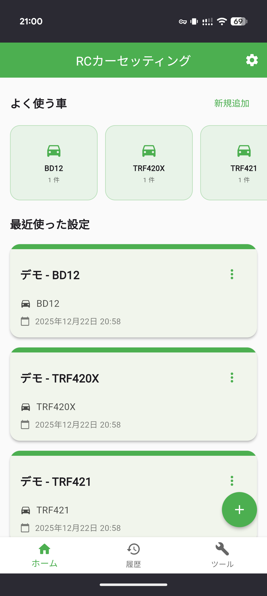
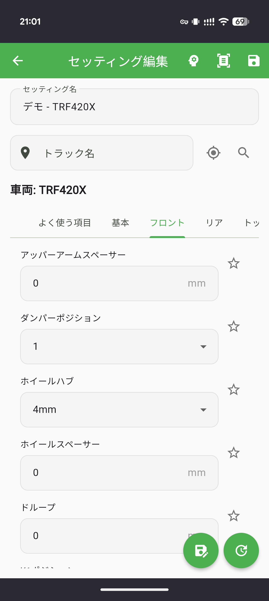

# RC Setting Manager - ラジコンセッティング記録アプリ

ラジコンのセッティングをスマホアプリで記録・管理するアプリです。
セッティングを記録するだけではなく、AIによる分析や画像からの自動読み取りも可能です。
主に競技RCツーリングカー向けの、開発初期の個人開発アプリです。

[Web版を試す](https://akiii2024.github.io/RC_Setting_Manager/) · [Privacy Policy](https://akiii2024.github.io/RC_Setting_Manager/privacy.html) · [不具合報告・問い合わせ](https://github.com/akiii2024/RC_Setting_Manager/issues)

現在の公開版は端末内保存が中心で、アカウントへのログイン・クラウド同期・デバイス間同期は無効です。AI・OCR・天気は同意して利用した場合に外部サービスへ通信します。扱う情報・送信先・削除方法は [Privacy Policy](web/privacy.html)を参照してください。

<div align="left">
  
  
</div>

## できること

- ラジコンカーのセッティング情報を記録・管理
- 画像からセッティング値を自動読み取り（OCR機能）
- AIによるセッティングの分析とアドバイス
- 天気情報の取得と記録（同意・位置情報権限が必要）
- トラック情報の管理と路面タイプの記録
- 複数の車種に対応（現在標準対応：TAMIYA TRF420 / TRF420X / TRF421 / TRF421X、YOKOMO BD11 / BD12 / MS1.0 / MS2.0）
- セッティング履歴の管理
- データのインポート・エクスポート
- クラウド同期でデバイス間でデータ共有（現在の公開版では無効）

## 提供方式

| プラットフォーム|配布方法| 備考|
|---------------|---------------|---------------|
|Android|APK or PWA             |将来的にGoogle Playに公開予定 |
|iOS|PWA（<https://akiii2024.github.io/RC_Setting_Manager/>） |ipa配布予定、将来的にApp Storeに公開予定|
|Web|PWA（<https://akiii2024.github.io/RC_Setting_Manager/>） |オフライン動作対応|

## インストール方法

### Web版（PWA）

1. ブラウザで https://akiii2024.github.io/RC_Setting_Manager/ にアクセス
2. アドレスバーの「インストール」ボタンをクリック
3. または、メニューから「ホーム画面に追加」を選択

### APK版

1. [release](https://github.com/akiii2024/RC_Setting_Manager/releases)からapkをダウンロード
2. インストール


## アプリの使い方

1. 車種を選択

ホーム画面から使用するラジコンカーの車種を選択します。

2. セッティングを記録

各セッティング項目（キャンバー、トー、ロールセンターなど）の値を入力して保存します。

3. OCR機能で自動読み取り

セッティングシートの画像を撮影またはアップロードすると、AIが自動で値を読み取って入力します。

4. AIアドバイスを活用

現在のセッティングや天気・トラック情報を基に、AIが参考となるセッティングを提案します。

5. 履歴を確認

過去のセッティング履歴を確認し、比較・分析することができます。

## 主な機能

- セッティング管理（複数の車種に対応）
- OCR機能（画像からセッティング値を自動読み取り）
- AIアドバイザー（セッティングの分析と提案）
- 天気情報の取得（現在位置の気温・湿度などを記録）
- トラック情報管理（路面タイプの記録）
- データのインポート・エクスポート（バックアップと復元）
- クラウド同期（アカウントログイン・データ同期は現在無効）
- セッティング履歴（過去の記録を確認・比較）
- 計算ツール（ギヤレシオ計算など）
- ダークモード対応
- 日本語・英語対応

## AIプロバイダーの設定

開発者モードを有効にすると、OpenAI、Anthropic、Gemini、OpenCode Goのうち使用するプロバイダーを「設定 → AIプロバイダー・APIキー」で選べます。標準GeminiはFirebase Functionsを経由し、個人APIは入力したAPIキーとモデルを使って選択先へ直接通信します。AIアドバイザー、OCR、テレメトリーAI分析は、ここで選択したプロバイダーを使用します。

OpenCode Goでは対応モデルとして`glm-5.3-flash`（既定・画像対応）、`glm-5.3`（テキストのみ）、`kimi-k3`、`gpt-6-luna`、`claude-haiku-5-5`、`minimax-m3`を選べます。OpenCode Goは公式にはコーディングエージェント向けのサービスです。RC用途での受入確認と実APIキーによる疎通確認は未実施のため、利用結果を確認してから使用してください。接続テストは小さな生成リクエストを行うため、利用枠を消費します。詳細は[OpenCode Go公式ドキュメント](https://opencode.ai/v2/docs/console/go/)を参照してください。

OpenCode Goの個人API接続はアプリ版のみ対応します。Web版はCORS制約のため対応を保留しており、Firebase Functionsによる中継は行いません。通信にはアプリ識別用User-Agentと会話単位のランダムなセッションヘッダーを付けますが、端末識別子や個人識別子は送信しません。

APIキーはソースコードや設定バックアップには含めず、ネイティブ版ではOSのセキュアストレージに保存します。Web版では既存対応プロバイダーのキーを永続保存せずタブ内メモリだけに保持するため、再読み込み後は再入力が必要です。OpenCode GoのキーとセッションIDもバックアップや設定同期には含めません。表示中はブラウザ上のコードからキーを利用できるため、信頼できるHTTPS環境で、利用制限を設定した専用キーを使用してください。

## Firebase Functions の設定

OpenWeatherと標準GeminiのAPI keyはFlutterアプリには埋め込まず、Firebase FunctionsのSecret Managerに保存します。

```bash
firebase functions:secrets:set OPENWEATHER_API_KEY
firebase functions:secrets:set GEMINI_API_KEY
firebase deploy --only functions
```

標準GeminiのAIアドバイザーは`generateSettingAdvice`・`generateGeminiContent`、構造化OCRは`extractSettingSheet`を使用します。個人設定プロバイダーのキーはFunctionsへ送信しません。

Functions のリージョンは既定で `asia-northeast1` です。変更する場合は Flutter ビルド時に `--dart-define=FIREBASE_FUNCTIONS_REGION=your-region` を指定してください。

## ライセンス・提供元表示

利用しているOSSとフォントのライセンスは「設定 → アプリについて → オープンソースライセンス」から確認できます。天気データはOpenWeather提供で、表示付近に公式ロゴとリンクを掲載します。

依存を更新した際は `flutter pub get` 後に `node tool/sync_third_party_licenses.mjs` で追加文書を同期し、差分を確認してください。Android/iOSのSDK通知の再生成・公開前確認は [ライセンス収集手順](docs/NATIVE_LICENSES.md)を参照してください。

## システム要件

### 対応デバイス・OS

#### Android
- **OSバージョン**: Android 7.0（API 24）以上
- **インストール方法**: APKファイルまたはPWA（プログレッシブウェブアプリ）

#### iOS
- **インストール方法**: PWA（プログレッシブウェブアプリ）
- **アクセスURL**: <https://akiii2024.github.io/RC_Setting_Manager/>
- **備考**: 将来的にApp Storeでの配布を予定

#### Web（PC・タブレット）
- **対応ブラウザ**: Chrome、Safari、Firefox、Edge等の主要ブラウザ
- **アクセスURL**: <https://akiii2024.github.io/RC_Setting_Manager/>
- **PWA対応**: ブラウザからホーム画面にインストール可能

### 必要な機能・権限

- **カメラ**: OCR機能でセッティングシートの画像を撮影する場合に必要
- **ストレージ**: セッティングデータの保存に必要
- **インターネット接続**:
  - 基本的な機能（セッティング記録・編集）はオフラインでも利用可能
  - 初回読み込み・更新・AI機能・OCR機能・天気情報の取得にはインターネット接続が必要（標準Gemini・天気はFirebaseの匿名認証・App Checkを使用）

### 推奨環境

- **ストレージ容量**: セッティングデータの保存に応じた空き容量が必要（目安：数十MB以上）
- **メモリ**: スムーズな動作のため、十分な空きメモリを推奨
- **画面サイズ**: スマートフォン・タブレット・PCの各種画面サイズに対応

### 動作確認環境

以下の環境でテストを行っています。
- Samsung Galaxy S24 - Android 16 One UI 8.0
- Google Pixel 10 Pro - Android 16
- iPhone 15 Pro Max - iOS 17.5.1
